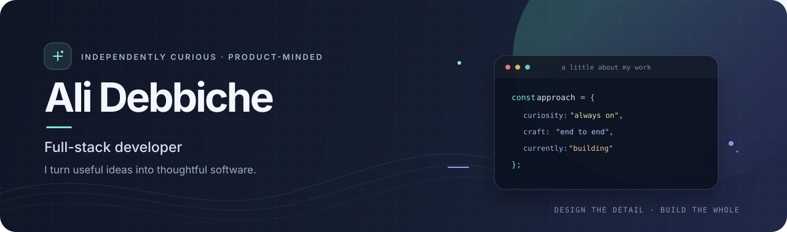

  
   
  <a href="https://ali-debbiche.vercel.app/"><strong>Explore my portfolio ↗</strong></a>
  &nbsp;&nbsp;·&nbsp;&nbsp;
  <a href="https://linkedin.com/in/ali-debbiche">LinkedIn</a>
  &nbsp;&nbsp;·&nbsp;&nbsp;
  <a href="mailto:debbicheali04@gmail.com">Say hello</a>
    
  
  
  
  
  

 

> **I like software that earns its place in someone’s day.**  
> I’m Ali — a full-stack developer exploring the space between product ideas and the systems that make them work. I build across web, desktop, and mobile, and care about the whole experience: how it feels to use, what happens behind the scenes, and whether it’s dependable when it matters.

 

## A few things I care about

<table>
  <tr>
    <td width="33%" valign="top">
      <strong>◈ Useful by design</strong>  
      Start with a real need. Keep the interface clear, the workflow coherent, and the details intentional.
    </td>
    <td width="33%" valign="top">
      <strong>⌘ Thoughtful engineering</strong>  
      Make the moving parts understandable. Build features with care for data, privacy, and the people using them.
    </td>
    <td width="33%" valign="top">
      <strong>↗ Learn by shipping</strong>  
      I enjoy stretching beyond familiar tools and turning new ideas into working, testable products.
    </td>
  </tr>
</table>

## Selected work

<table>
  <tr>
    <td width="50%" valign="top">
      <h3>✦ FocusPilot</h3>
      
<strong>A privacy-conscious AI desktop assistant for Windows.</strong>

      
A floating workspace that brings AI chat, screen analysis, live transcription, interview practice, and coding help into one desktop app.

      
What makes it interesting: combining screen and audio context, a sandboxed Electron/React architecture, and local SQLite storage with encrypted API-key handling.

      
Electron · React · TypeScript · Gemini · SQLite

      <a href="https://github.com/alidebbich/FocusPilot">Explore FocusPilot →</a>
    </td>
    <td width="50%" valign="top">
      <h3>◷ Momentum</h3>
      
<strong>An alarm that helps make a morning routine stick.</strong>

      
This Android habit tracker connects alarms to habits and asks you to complete a small mission before dismissing the alarm.

      
It brings together exact alarm scheduling, lock-screen behavior, habit streaks, custom sounds, and a distinct dark interface.

      
Flutter · Dart · Android · SQLite

      <a href="https://github.com/alidebbich/Habit-Tracker">Explore Momentum →</a>
    </td>
  </tr>
</table>

  More experiments and projects live in my <a href="https://github.com/alidebbich?tab=repositories">repositories</a> — including <a href="https://github.com/alidebbich/fi-thnitek">Fi-Thnitek</a> and <a href="https://github.com/alidebbich/wakeforce-ai-backend">WakeForce AI Backend</a>.

 

## My toolkit

| Area | Tools I work with |
| --- | --- |
| **Languages** | JavaScript �� TypeScript · Python · Dart · HTML · CSS |
| **Web** | React · Vue · Next.js · Tailwind CSS · Bootstrap |
| **Server & data** | Node.js · Express · NestJS · Django · Flask · PostgreSQL · MongoDB · MySQL · Firebase |
| **Apps & workflow** | Flutter · Electron · Git · GitHub · Docker · Postman |

## Around GitHub

I use this space to build, experiment, and share projects. The repositories above show a few different sides of that work: desktop AI tooling, mobile product design, and web application development. I’m always glad to connect with people who care about building thoughtful software.

   
  <a href="https://ali-debbiche.vercel.app/"><strong>MORE ABOUT ME, PROJECT DETAILS & DEMOS →</strong></a>
    
  <a href="mailto:debbicheali04@gmail.com">debbicheali04@gmail.com</a>
  &nbsp;&nbsp;·&nbsp;&nbsp;
  <a href="https://linkedin.com/in/ali-debbiche">Connect on LinkedIn</a>
  &nbsp;&nbsp;·&nbsp;&nbsp;
  <a href="https://github.com/alidebbich">Browse my repositories</a>
    
  Thanks for stopping by — have a great day ✦

